# EC2 Nginx Deployment with Terraform

This project uses Terraform to launch an Ubuntu 20.04 LTS EC2 instance in an existing AWS default VPC, install Nginx through `user_data`, and serve:

> Welcome to the Terraform-managed Nginx Server on Ubuntu

The screenshots below show deployment in **ap-south-1 (Mumbai)**, the working webpage, and successful destruction of the two managed resources. The instance has been destroyed; its former public IP is included only as historical evidence.

## Infrastructure

| Component | Configuration |
| --- | --- |
| AWS provider | HashiCorp AWS; selected version recorded in `.terraform.lock.hcl` |
| Region | `ap-south-1` by default, configurable through `aws_region` |
| EC2 | `t3.micro`, official Canonical Ubuntu 20.04 LTS x86_64 AMI |
| Networking | Existing default VPC and existing default subnet; automatic public IPv4 |
| Security group | Inbound HTTP TCP/80 and SSH TCP/22 from `0.0.0.0/0` by default |
| Outbound access | Allowed for package downloads and responses |
| Root disk | 8 GiB encrypted `gp3`, deleted on instance termination |
| Startup | Installs Nginx, replaces the default page, checks configuration and enables the service |
| Outputs | Instance public IPv4 and HTTP website URL |
| Tags | Project/management tags and descriptive resource names |

Terraform creates **one EC2 instance and one security group**. The root disk is managed within the instance resource. It reads the existing default VPC, default subnets, and AMI through data sources. It creates no VPC, subnet, internet gateway, Elastic IP or key pair.

## Repository contents

```text
terraform-nginx-ubuntu/
|-- main.tf                     # Provider, lookups, security group, EC2 and startup script
|-- variables.tf                # Region, existing key name and SSH source range
|-- outputs.tf                  # Public IP and website URL
|-- terraform.tfvars.example    # Example local inputs
|-- .terraform.lock.hcl         # Provider version/checksums
|-- .gitignore
|-- .gitattributes
|-- README.md
|-- screenshots/               # Original deployment and teardown evidence
`-- tests/                     # Local mock tests; no live AWS deployment
```

## Prerequisites

- Terraform CLI 1.7 or newer, below 2.0.
- AWS credentials configured locally through the standard credential chain, with permission to describe existing networking/AMIs and create, tag and delete the EC2 instance and security group.
- An existing default VPC and default subnet with internet access in the selected region. The code selects the first default subnet ID in sorted order.
- An existing EC2 key pair in the same region. Keep its private key outside the repository.
- Account and regional support for the configured instance type and Ubuntu AMI.

## Run

Open a terminal inside this folder. In PowerShell, copy the example inputs:

```powershell
Copy-Item terraform.tfvars.example terraform.tfvars
```

Edit `terraform.tfvars` and replace the example key name with your existing EC2 key pair name, not a private-key path:

```hcl
aws_region = "ap-south-1"
key_name   = "YOUR_EXISTING_EC2_KEY_PAIR_NAME"
ssh_cidr   = "0.0.0.0/0"
```

No personal IP is required. Optionally restrict SSH by setting `ssh_cidr` to your public IPv4 followed by `/32`. Without a local input file, Terraform prompts for the required key name; region and SSH source have defaults.

Initialize and preview:

```text
terraform init
terraform plan
```

For a fresh deployment, expect **2 to add, 0 to change, 0 to destroy**. Review the resources, region and selected subnet, then apply:

```text
terraform apply
```

Review the displayed plan and enter `yes`. Copy `public_ip` and `website_url` from the final output. Allow a few minutes for first-boot installation, then open the HTTP URL and verify the exact welcome sentence. HTTPS is not configured.

If an earlier apply created the security group but failed to launch EC2, a retry can correctly report only **1 added**. Terraform reuses the resource already recorded in local state.

## Destroy

After collecting evidence, run from the same folder with the same state and account:

```text
terraform destroy
```

Review the deletion plan and enter `yes`. For the complete deployment, expect **2 destroyed**. The root disk is deleted with the instance and its automatic public IP is released. Existing networking and the pre-existing key pair remain.

Keep state until destruction succeeds. Deleting files does not delete AWS infrastructure.

## Deployment evidence

These are original deployment screenshots. The apply and browser images show the same public IP; the apply, EC2, security-group and destroy images identify the same managed resources.

### Working Nginx page

The browser displays the exact required welcome message at the IP shown in Terraform's output.

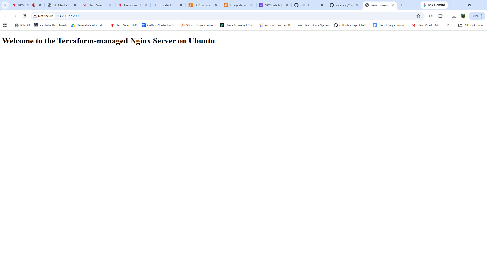

### Successful provisioning and outputs

The final apply reports **2 added** and outputs the public IP and HTTP URL.

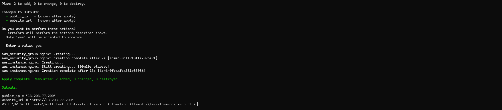

### Successful teardown

Terraform reports successful destruction of the EC2 instance and security group.

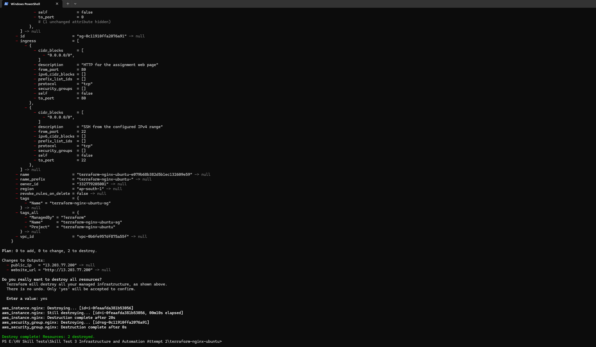

<details>
<summary>Initialization and full plan</summary>

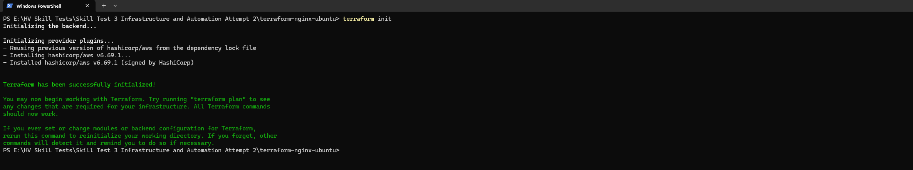

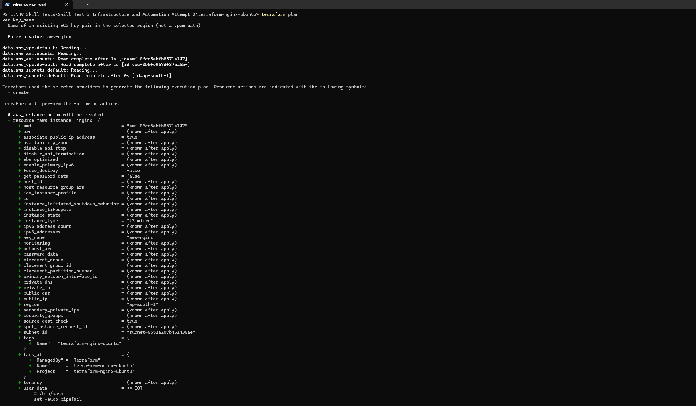

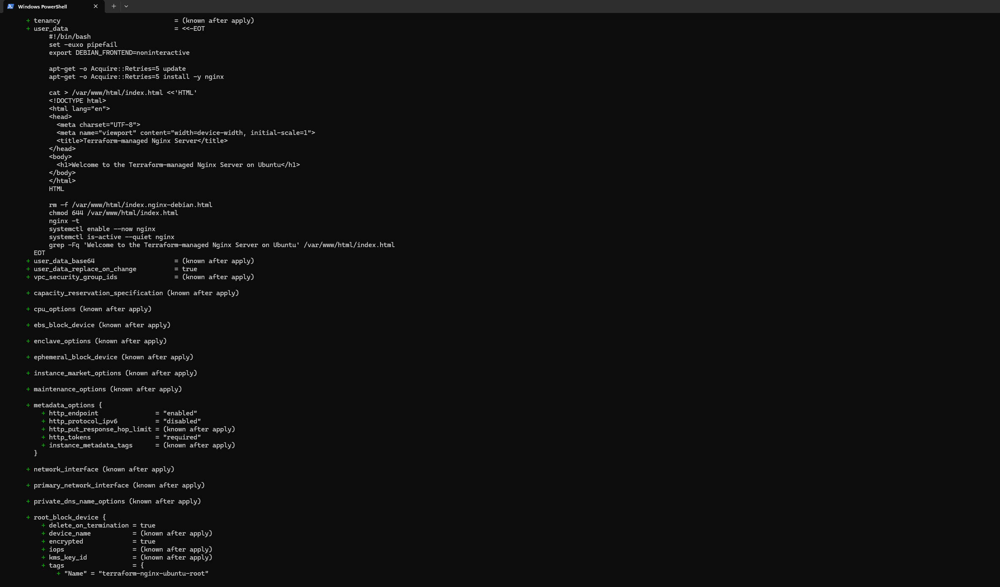

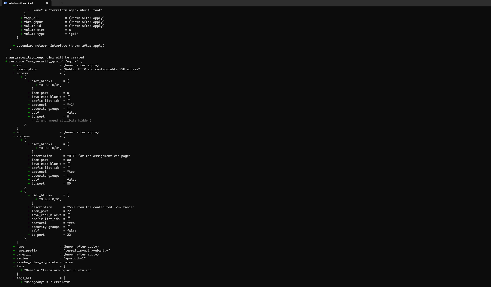

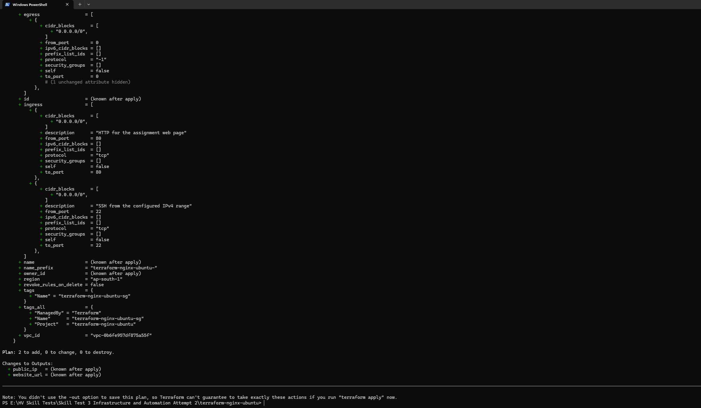

</details>

<details>
<summary>EC2 instance, Ubuntu AMI, default VPC and inbound rules</summary>

The EC2 image shows the instance running as `t3.micro` in Mumbai. Its status checks were still initializing when captured; this image does not establish that they had passed.

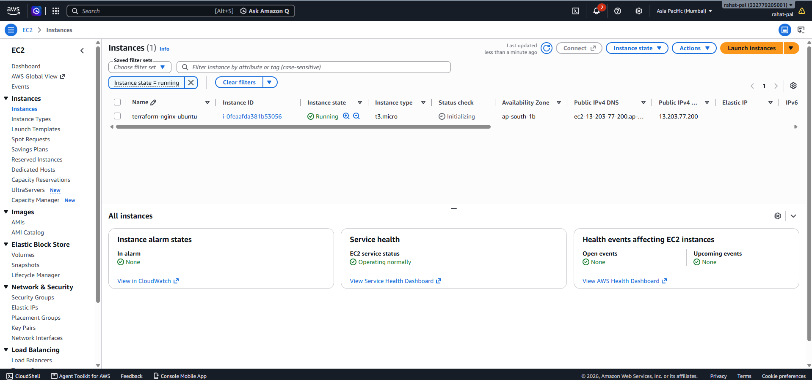

The AMI view identifies Canonical Ubuntu 20.04, x86_64, matching the AMI in the plan.

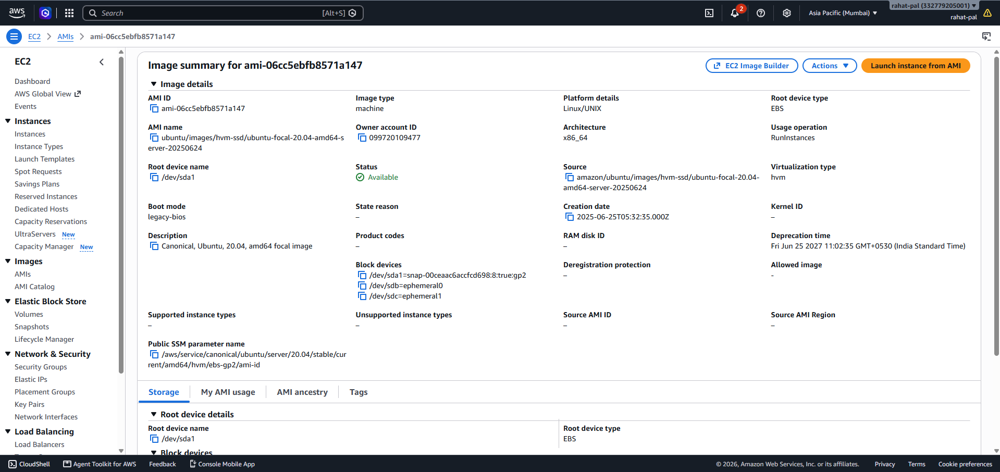

The VPC view shows **Default VPC: Yes** and the existing subnet selected in the plan.

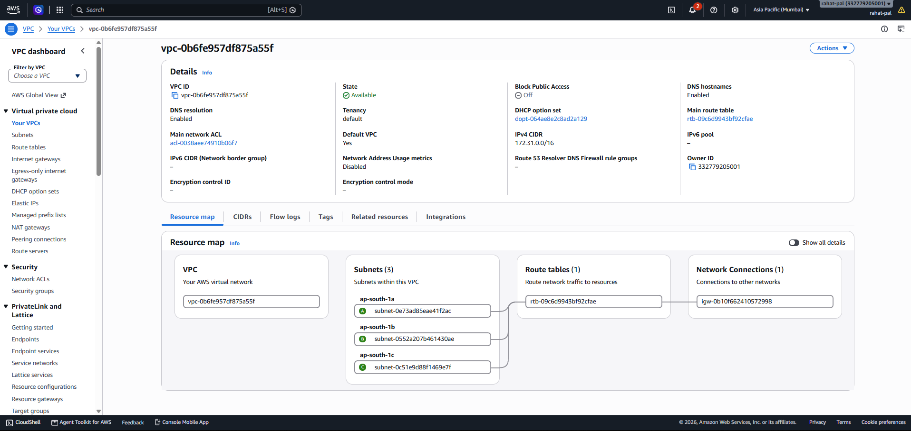

The security group matches the group created by apply and permits TCP/80 and TCP/22 from `0.0.0.0/0`.

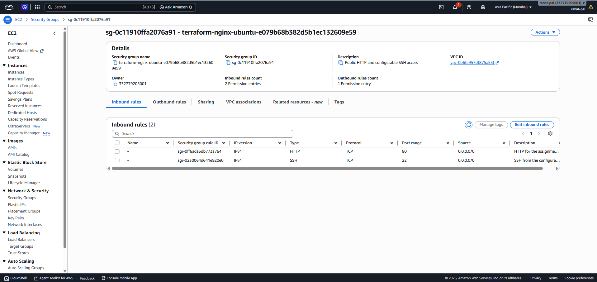

</details>

Evidence does not include a separate SSH service-check image or post-destroy AWS Console images. Teardown is demonstrated by the successful Terraform destroy output; the browser image demonstrates the served content.

## Local checks

Optional local mock-test instructions are in [tests/README.md](tests/README.md). These exercise the configuration without creating AWS resources and are separate from the assignment's `init`, `plan`, `apply` and `destroy` workflow.

## Submission and operational notes

- Commit the Terraform files, lock file, example inputs, README, tests and screenshots. Local state, provider binaries, private keys, credentials and `terraform.tfvars` are excluded by `.gitignore`.
- Original screenshots retain AWS account identifiers and the console account name. No credential values or private-key contents are visible. Use repository visibility consistent with your course's sharing requirements.
- SSH is public by default and requires key authentication. Restrict its source when using the configuration beyond this short-lived lab.
- EC2, EBS and public IPv4 can incur charges. Destroy resources when finished; do not assume Free Tier eligibility means all usage is free.
- Ubuntu 20.04 is retained for the assignment. Its standard maintenance ended in May 2025; see [Canonical's support information](https://ubuntu.com/20-04).
- A future plan may select a newer matching AMI and replace the instance. Changing user data also replaces the instance.

